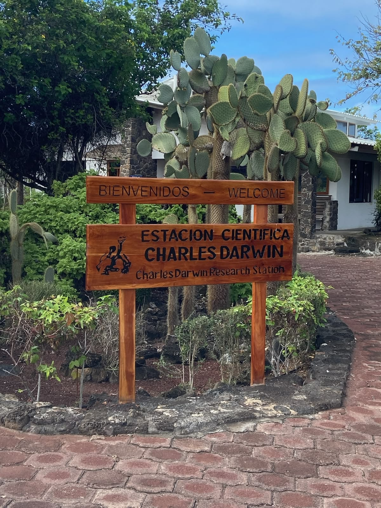
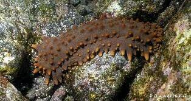
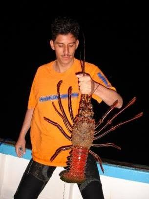
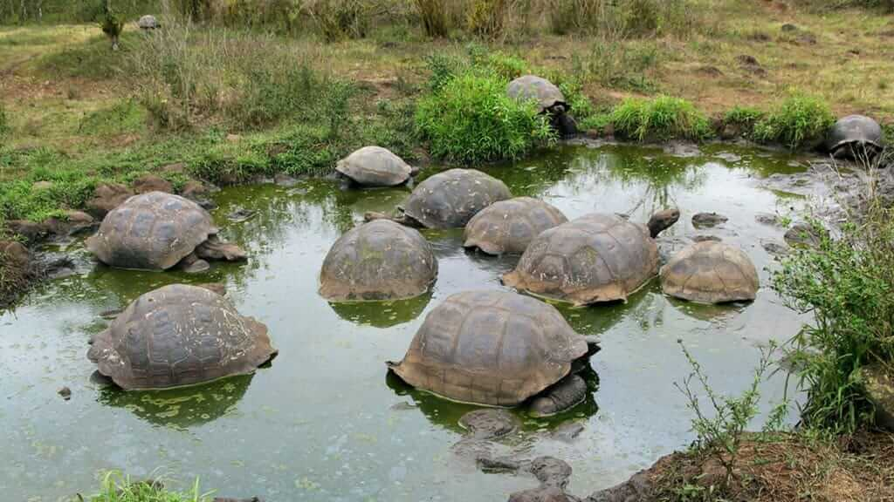
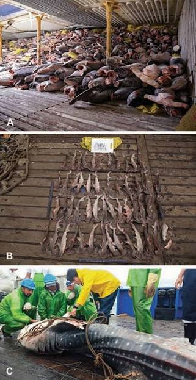
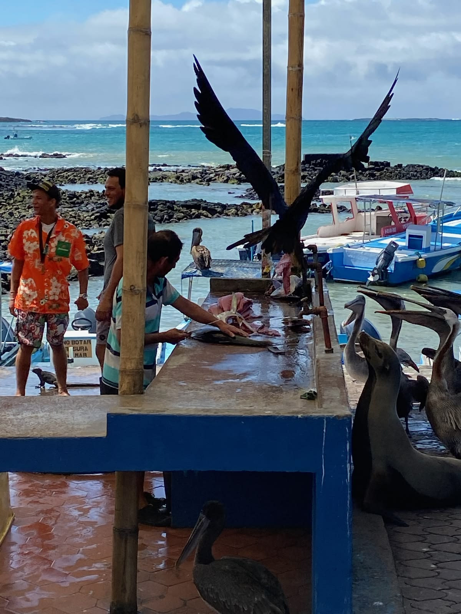
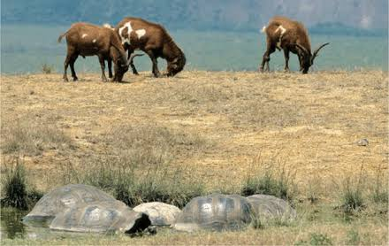
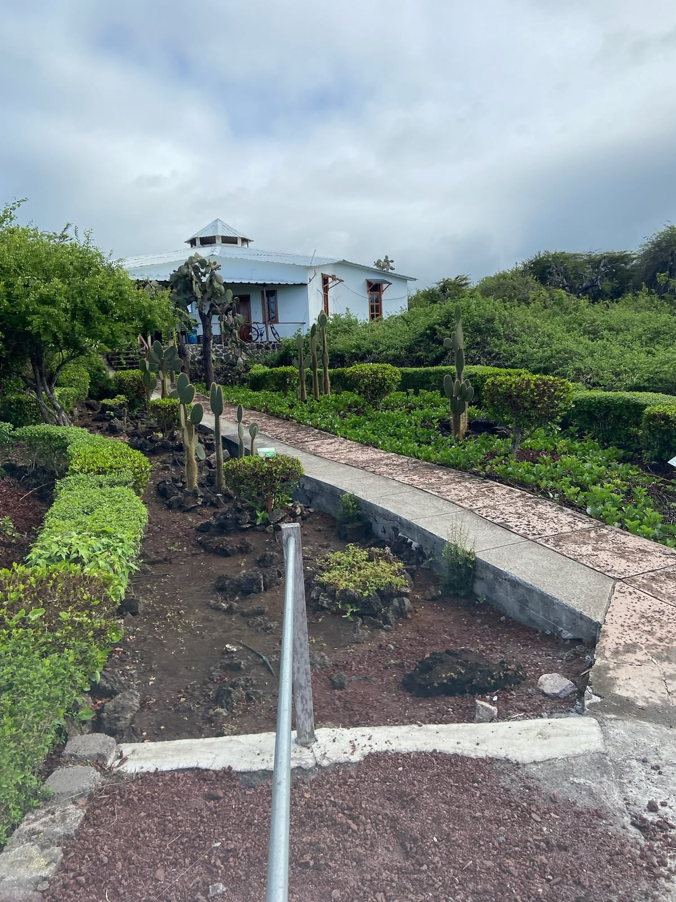


The Galápagos Islands are often recognized for their unique wildlife and importance to scientific research, but their history also involves conflict over who has the right to use and protect their natural resources. Although the islands are geographically distant from most of the world, secluded in the Pacific, their environmental history has been heavily influenced by activities taking place beyond their shores. The map provided, demonstrates how connections to mainland Ecuador, Eastern Asia, and Western Europe have contributed to both environmental threats and conservation efforts. In particular, migration, international and local fishing demand, and commercial shipping have placed pressure on the islands' ecosystem, while government policies and international organizations have attempted to address these issues. Ultimately, the history of the Galápagos demonstrates that protecting an isolated ecosystem requires large-scale cooperation between local communities, national governments, and international organizations.

## Migration Restrictions: Tourism and Population Growth

<table style="float: right; width: auto; margin-left: 20px; margin-bottom: 10px;">
  <tr>
    <td align="center" style="max-width: 250px;">
      
       
      <em>Image taken by Hannah Landman at the Charles Darwin Research Station (June 28, 2022).</em>
    </td>
  </tr>
</table>
When looking at the map, an important connection between Guayaquil and Seymour Airport on Baltra Island is visible. This particular line depicts a common migration and tourism route. During the 1980s, 1990s, and 2000s, the growth of tourism created employment opportunities in the Galápagos, attracting people from mainland Ecuador. [^1] However, increasing migration also placed pressure on the islands' limited resources and contributed to concerns about environmental damage and invasive species. In response, Ecuador passed the Special Law for the Conservation and Sustainable Development of the Province of Galápagos in 1998. [^2] The law introduced restrictions on migration and residency, regulated tourism and fishing, and strengthened protections for the islands' surrounding waters. The Galápagos Conservation Trust, established in 1995, also identifies the Special Law as an important development in establishing a framework for managing immigration and fisheries. [^3] 
 

The location of Seymour Airport is particularly important because it represents one of the main entry points for people traveling from mainland Ecuador. The tourism and migration line illustrates how the islands' growing popularity created challenges that required government intervention. However, these policies did not always receive support from the people most affected by them. Puerto Ayora is marked on the map as the location of several conflicts between local fishermen and conservation officials. In a December 2000 report, South American correspondent Alex Bellos described how fishermen had taken tortoises hostage to protest the strict fishing quotas with residents saying:
> "They come and tell us that now we cannot do the same things we have done for a lifetime."
>
> Alex Bellos, Galapagos Turmoil: Tortoises Dragged into Fishing War (The Guardian, December 30, 2000). [^4]
 
 

  

    
     
    <em>Brown sea cucumber (Isostichopus fuscus), a species threatened by illegal commercial harvesting around the islands.<a href="#fn:26">26</a></em>
  

  

    
     
    <em>Red spiny lobster (Panulirus penicillatus), a species showing signs of recovery following overexploitation.<a href="#fn:27">27</a></em>
  

The most notable protests occurred from 1995 to 2004 regarding fishing limits for sea cucumbers, sharks, lobsters, and the use of semi-industrial techniques. A 1995 New York Times article captures the energy and public mindset in the very beginning of this trend. Despite increased income for the Park Service, the municipalities failed to see an improvement in their quality of life, they felt neglected and in turn made dire threats including burning down facilities and slaughtering the protected wildlife. [^5] The public became more violent particularly in 1996 when protesters slit the throats of nine giant tortoises and then vandalizing and looting facilities and holding numerous individuals and animals hostage. [^6] These events demonstrate that conservation does not stop at protecting wildlife. Mainland Ecuador and the Galápagos Islands are deeply connected as represented by the line between the Manta port and Puerto Ayora. The Ecuadorian government has a long history of struggling to balance the needs of the residents and the needs of the wildlife and researchers.
<table style="float: right; width: auto; margin-left: 20px; margin-bottom: 10px;">
  <tr>
    <td align="center" style="max-width: 500px;">
      
       
      <em>Galápagos giant tortoise, a species affected by historical human exploitation and introduced species.<a href="#fn:28">28</a></em>
    </td>
  </tr>
</table>
 

## International Fishing and the Galápagos Marine Reserve

Before turning to the fishing lines, it helps to explain how I sorted the places on my map into two types: vertical and horizontal. A vertical place is a location inside the Galápagos where history builds up in layers, so a single spot can be read through the laws, conflicts, and restoration projects that happened there over time. A horizontal place is a location outside the islands, such as a port, a market, or an organization's headquarters, whose importance comes from how it reaches out and connects to the Galápagos through trade, migration, funding, or oversight. The lines on the map tie the two together by showing how demand and decisions in horizontal places shaped events in vertical ones.

The Galápagos Marine Reserve (GMR) is a clear example of a vertical place. Ecuador first protected the surrounding waters in 1986 as the Galápagos Marine Resources Reserve, a 15-nautical-mile buffer around the islands, but this early reserve did not have formal protected-area status. [^7] The 1998 Special Law created the GMR as it is known today, extending protection 40 nautical miles from the islands and excluding industrial fishing fleets. [^7] [^8] UNESCO added the marine reserve to the Galápagos World Heritage Site in 2001. [^9] On the map, two lines run from Quito, which represents Ecuador's national government, to the Special Law and to the GMR, because these protections were written and enforced by the national government. The Special Law is placed at Seymour Airport, where its migration controls are most visible to people arriving from the mainland. Even with this framework, managing fishing has never been the work of one agency alone. Researchers have studied how governance of the islands' small-scale fishing sector developed through collaboration among many organizations at different levels, which helps explain why fishing rules have remained contested. [^10]
<table style="float: right; width: auto; margin-left: 20px; margin-bottom: 10px;">
  <tr>
    <td align="center" style="max-width: 250px;">
      
       
      <em>Image assembled by research team depicting sample of shark carcasses seized from vessel Fu Yuan Yu Leng 999. (A.) inside one of the vessel freezers. (B.) unborn scalloped hammerhead sharks. (C.) whale shark. <a href="#fn:11">11</a></em>
    </td>
  </tr>
</table>
Pressure on the reserve also came from far away. The long lines from Guangzhou and Tokyo are horizontal connections. They represent international seafood demand, particularly for shark fins and tuna, rather than the exact routes of any vessel. This demand matters because shark fishing driven by the fin trade is considered the leading cause of shark population declines worldwide. [^11]

The clearest example of this connection is the detention of the *Fu Yuan Yu Leng 999*. This Chinese-flagged ship was a reefer, a refrigerated cargo vessel that collects catch from other boats instead of fishing itself. In August 2017, the Galápagos National Park's monitoring center alerted the Ecuadorian Navy to a large vessel crossing the reserve without authorization, and the ship was detained about twelve miles north of Punta Pitt on San Cristóbal Island. [^11] Its cargo included 7,639 sharks, one of the largest seizures recorded. Researchers examined a sample of 929 of them, about 12 percent, and identified twelve species, nine of which the IUCN considers Vulnerable or at higher risk. [^11] The vessel was escorted to Puerto Baquerizo Moreno, where a judge sentenced the crew to prison terms of between one and four years. [^11] [^12] Punta Pitt is a vertical place because it records one moment in the reserve's enforcement history. The lines from Guangzhou and Tokyo to Punta Pitt are symbolic. The research I cite does not trace this particular shipment to a named buyer, so the lines represent the wider markets that fuel this kind of fishing.
 
 
<table style="float: left; width: auto; margin-right: 20px; margin-bottom: 10px;">
  <tr>
    <td align="center" style="max-width: 250px;">
      
       
      <em>Image taken by Hannah Landman of the Santa Cruz Fish Market (June 28, 2022).</em>
    </td>
  </tr>
</table>
Not all fishing pressure came from overseas. Manta is Ecuador's major tuna port and appears on the map as a horizontal place. Researchers describe it as the most important tuna processing cluster in the Eastern Pacific, receiving landings from Ecuador's fleet and from other fleets. [^13] I connect Manta to Puerto Ayora, where the violent protests took place, to show that the dispute over fishing limits in the islands was part of Ecuador's wider fishing economy and not only a local conflict. Like the other lines, this one is symbolic rather than a record of vessel routes. Fishing pressure comes from many more places than my map can show, and authorities must track and detain vessels from around the world.
 

## International Collaboration and Environmental Restoration
<table style="float: right; width: auto; margin-left: 20px; margin-bottom: 10px;">
  <tr>
    <td align="center" style="max-width: 250px;">
      
       
      <em>Image taken by Hannah Landman of the inside of the Charles Darwin Research Center on Santa Cruz Island (June 28, 2022).</em>
    </td>
  </tr>
</table>
Not all international connections have contributed to environmental threats. My map also includes UNESCO's World Heritage Centre in Paris, the International Union for Conservation of Nature (IUCN) in Gland, Switzerland, and the Galápagos Conservation Trust (GCT) in London. These are horizontal places because, from a distance, they connected the islands to international oversight, scientific expertise, and funding.

UNESCO first recognized the Galápagos as a World Heritage Site in 1978 and added the marine reserve in 2001. [^9] In 2007, the islands were placed on the List of World Heritage in Danger at Ecuador's own request. UNESCO's records point to threats such as invasive species, a high immigration rate, unsustainable tourism development, and excessive fishing pressure in the reserve. [^14] On the map, a line from Paris leads to the 2001 World Heritage Site and a line from Gland leads to the 2007 In Danger listing. IUCN, which advises UNESCO on natural sites, took part in the April 2007 mission to the islands and recommended the danger listing. [^14] [^15] In 2010, the World Heritage Committee removed the islands from the danger list after recognizing Ecuador's progress on corrective measures, while still asking for follow-up on remaining concerns. [^16]
 
 
<table style="float: left; width: auto; margin-right: 20px; margin-bottom: 10px;">
  <tr>
    <td align="center" style="max-width: 300px;">
      
       
      <em>Image of invasive feral goats on Islabela Island, feeding off the grass land and harmfully altering the giant tortoise environment.<a href="#fn:29">29</a></em>
    </td>
  </tr>
</table>
The Galápagos Conservation Trust, established in London in 1995, is a different kind of horizontal place: a charity that raises support abroad for conservation in the islands. [^3] My map connects London to two restoration projects, which are vertical places because their results can be seen on particular islands. Project Isabela, initiated in 1997 and completed in 2006, set out to remove introduced goats, pigs, and donkeys from northern Isabela, Santiago, and Pinta, after goats had devastated the vegetation and tortoise habitat on Alcedo Volcano. [^17] GCT was one of several organizations that supported it. [^18] Project Pinzón followed. Introduced black rats had prevented Pinzón giant tortoise hatchlings from surviving for roughly a century. In December 2012, the Galápagos National Park Directorate, Island Conservation, and other partners eradicated the rats, and in December 2014 researchers found the first surviving wild hatchlings in more than 100 years. [^19] GCT lists the island's restoration among its projects. [^20] Together, these projects show how scientific research, international funding, and cooperation with Ecuadorian conservation authorities have helped restore damaged ecosystems.
 

Conservation also happened far from the islands, in the markets that drive fishing. Two points in Eastern Asia, Taiwan and Beijing, capture this change. They have no lines to the islands because they represent shifts in policy and public attitudes, not flows of people or goods. In 2012, Taiwan adopted rules requiring sharks to be landed with their fins attached, and international media described it as the first Asian government to ban shark finning. [^21] [^22] In China, the conservation group WildAid began a shark fin campaign in 2006 that used public service announcements featuring basketball star Yao Ming, with a simple message:
> "When the buying stops, the killing can too."
>
> WildAid, Evidence of Decline in Shark Fin Demand: China (WildAid, August 2014). [^23]

WildAid's own 2014 survey reported that shark fin vendors in Guangzhou saw sales fall by 82 percent over two years. [^23] Because this figure comes from the organization that ran the campaign, and because the Chinese government also announced a ban on shark fin at official banquets in 2012, the decline cannot be credited to a single cause. [^23] It also did not end the threat to sharks. The 2017 seizure of the *Fu Yuan Yu Leng 999* shows that pressure on shark populations continued.

## Methodology for Mapping

I selected the period from approximately 1980 to 2019 because it captures several decades of growing tourism, migration, fishing conflict, and conservation policy. This period also includes important events such as the 1998 Special Law, the 2001 Jessica oil spill, the 2007 UNESCO danger listing, and the 2017 detention of the *Fu Yuan Yu Leng 999*. Some organizations and conservation efforts began earlier, but I included them because they help explain the international relationships that developed during this period.

The map uses points, lines, and polygons. Points mark specific places, and each one is classified as vertical (within the islands) or horizontal (connected to the islands from elsewhere), as explained above. Every point is named for a real place, and the event or theme it represents is described in its pop-up. Lines show the connections between places, such as migration and tourism, domestic and international fishing, national governance, conservation support, and international oversight. Polygons group places into clusters. Three clusters connect to the Galápagos Islands, which are also drawn as a polygon: Mainland Ecuador, Eastern Asia, and Western Europe. I chose these regions because each has a different relationship with the islands. Mainland Ecuador (Quito, Guayaquil, and Manta) represents migration, government policy, and domestic fishing. Eastern Asia (Guangzhou, Tokyo, Beijing, and Taiwan) represents seafood markets, fishing demand, and changing attitudes toward shark fin. Western Europe (Paris, London, and Gland) represents international conservation organizations and environmental oversight. The polygons are loose shapes drawn around their points to show the regions, not political borders.

Individual points were selected based on their historical importance and their ability to represent larger relationships. For example, I used the headquarters of conservation organizations instead of mapping every place where they work. Similarly, I used Guangzhou and Tokyo to represent broader international markets rather than specific seafood transactions.

## Limitations

One limitation of my map is that it cannot show the full extent of environmental damage caused by human activity. The fishing lines represent international demand, but they cannot show the exact routes taken by vessels or how long those vessels remained within protected waters. The Jessica oil spill is another example of an event that a single point cannot fully represent. The tanker ran aground in January 2001 at the entrance to the port of Puerto Baquerizo Moreno on San Cristóbal, carrying about 160,000 gallons of diesel and 80,000 gallons of bunker fuel, according to UNESCO's records. [^24] The spill did not stay near the wreck. Slicks threatened Santa Cruz and Isabela, and the largest numbers of affected animals were reported on San Cristóbal and Santa Fe. [^25]
 
<table style="float: right; width: auto; margin-left: 20px; margin-bottom: 10px;">
  <tr>
    <td align="center" style="max-width: 250px;">
      
       
      <em>Image taken by Hannah Landman of map displayed at the Charles Darwin Research Center.</em>
    </td>
  </tr>
</table>
Additionally, some points represent general locations rather than exact boundaries. International organizations are represented by their headquarters, even though their conservation work takes place elsewhere, and the lines simplify complicated economic relationships involving multiple countries, industries, and fishing fleets. The vertical and horizontal categories also simplify. Many places, such as the GMR, are both rooted in local history and shaped by distant decisions. These limitations mean that the map represents broader historical relationships rather than the complete extent of every activity.
 
Finally, Ecuador's official language is Spanish, so many pieces of legislation are written in Spanish. I am not fluent in Spanish and do not have the resources at this time to translate a large number of documents. As a result, the sources I used are limited to those with English translations or those written for English-speaking audiences.

## Summary

Ultimately, my map demonstrates that the Galápagos Islands have never been completely isolated from the rest of the world. Their environmental history has been shaped by migration, international markets, government policies, and conservation organizations. By placing these locations and events together geographically, the map reveals relationships that might be difficult to recognize through written descriptions alone. It shows how decisions made thousands of miles away can have consequences for a relatively small group of islands, and how international cooperation can help protect them.

If you're interested in continuing to learn about the Galápagos' rich history and conservation efforts, take a look at my [Resources Page](resources.html) to find sources that may interest you or provide further detail on an event or subject you've learned about from this map. 

[^26] [^27] [^28] [^29]

[^1]: Jimmy Martínez-Ortiz, Alexandre M. Aires-da-Silva, Cleridy E. Lennert-Cody, and Mark N. Maunder, *The Ecuadorian Artisanal Fishery for Large Pelagics: Species Composition and Spatio-Temporal Dynamics* (PLOS ONE, 2015).
[^2]: MIT 12.000 Student Research Team, *The Special Law of Galápagos* (Massachusetts Institute of Technology, 2008).
[^3]: Galapagos Conservation Trust, *30 Years of Galapagos Conservation Trust* (Galapagos Conservation Trust, 2025).
[^4]: Alex Bellos, *Galapagos Turmoil: Tortoises Dragged into Fishing War* (The Guardian, December 30, 2000). 
[^5]: Douglas Jehl Schemo, *Galapagos Islands Journal: Homo Sapiens at War on Darwin’s Peaceful Isles* (The New York Times, November 28, 1995). 
[^6]: Jim Wyss, *Turmoil in Paradise: Galapagos Fishermen Revolt Against Strict Quota on Lobster* (San Francisco Chronicle, December 10, 2000).
[^7]: Andrés Pazmiño, *Silvia Serrao-Neumann, and Darryl Low Choy, Towards Comprehensive Policy Integration for the Sustainability of Small Islands: A Landscape-Scale Planning Approach for the Galápagos Islands* (Sustainability, 2018).
[^8]: Tyler D. Eddy, Alan M. Friedlander, and Pelayo Salinas de León, *Ecosystem Effects of Fishing and El Niño at the Galápagos Marine Reserve* (PeerJ, 2019).
[^9]: UNESCO World Heritage Committee, *Decision 25 COM XB: Galápagos Islands* [Extension to Include the Galápagos Marine Reserve] (UNESCO, 2001).
[^10]: Renato Cáceres, Jeremy Pittman, Mauricio Castrejón, and Peter Deadman, *The Evolution of Polycentric Governance in the Galapagos Small-Scale Fishing Sector* (Environmental Management, 2022).
[^11]: Elisa Bonaccorso et al., *International Fisheries Threaten Globally Endangered Sharks in the Eastern Tropical Pacific Ocean: The Case of the Fu Yuan Yu Leng 999 Reefer Vessel Seized Within the Galápagos Marine Reserve* (Scientific Reports, 2021).
[^12]: Silvia Bor, *Chinese Vessel Crew Detained in Galápagos Marine Reserve Sentenced for Transport and Possession of Endangered Sharks* (WildAid, August 30, 2017).
[^13]: Vishwanie Maharaj, *Complications of Designing Tenure Rights Programs for Highly Migratory Fisheries: Eastern Pacific Tropical Tuna Fisheries* (Food and Agriculture Organization of the United Nations, n.d.).
[^14]: UNESCO World Heritage Centre, *Galápagos Islands: State of Conservation* (UNESCO, n.d.).
[^15]: International Union for Conservation of Nature, *Thirteen World Heritage Sites Stay on Danger List* (IUCN, 2009).
[^16]: UNESCO World Heritage Committee, *Decision 34 COM 7A.15: Galápagos Islands (Ecuador)* (UNESCO, 2010).
[^17]: Galapagos Conservancy, *Project Isabela* (Galapagos Conservancy, n.d.).
[^18]: Galapagos Conservation Trust, *Isabela: Island Overview* (Galapagos Conservation Trust, n.d.).
[^19]: Galapagos Conservancy, *Project Pinzón* (Galapagos Conservancy, n.d.).
[^20]: Galapagos Conservation Trust, *Pinzón Island Restoration* (Galapagos Conservation Trust, n.d.).
[^21]: Council of Agriculture, *Executive Yuan (Taiwan), Directions on the Disposal of the Fins of the Shark Catches of Fishing Vessels* (January 19, 2012).
[^22]: In First for Asia, *Taiwan to Ban Shark Finning* (TIME, 2011).
[^23]: WildAid, *Evidence of Decline in Shark Fin Demand: China* (WildAid, August 2014).
[^24]: UNESCO World Heritage Centre, *Galápagos Islands: State of Conservation, 2001* (UNESCO, n.d.).
[^25]: Cedre, *Jessica* (Centre of Documentation, Research and Experimentation on Accidental Water Pollution, n.d.).
[^26]: M. Verónica Toral-Granda, *The Use of Calcareous Spicules for the Identification of the Galápagos Sea Cucumber Isostichopus fuscus on the International Market* (SPC Beche-de-mer Information Bulletin 22, July 2005), pp. 3–5.
[^27]: Castrejón Mauricioa, Viteri Cesarb, Moreno Jersonb, Vera Marianab, and Luis Suárez, *Galapagos Islands, Ecuador: Improving the Spiny Lobster Fishery in the Galapagos Marine Reserve* (Conservation International, January 2017), pp. 1-5.
[^28]: John Potts, *Galapagos Tortoise: Where, When & How to Spot These Gentle Giants* (Happy Gringo Travel, n.d.).
[^29]: Jerry Guo, *The Galápagos Islands Kiss Their Goat Problem Good* (Science, September 15, 2006), pp. 1567.
