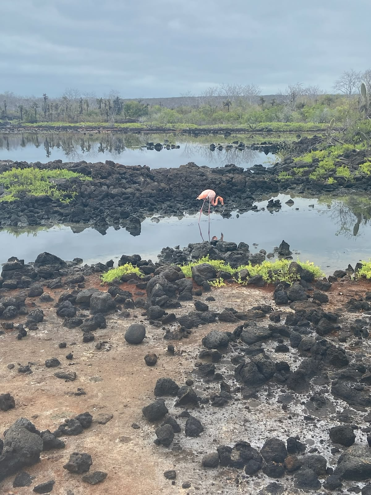


<table align="right">
  <tr>
    <td align="center">
      
       
      <em>Image taken by Hannah Landman on Isabela Island on June 29th 2022.</em>
    </td>
  </tr>
</table>
The Galápagos Islands are often recognized for their unique wildlife and importance to scientific research, but their history also involves conflict over who has the right to use and protect their natural resources. Although the islands are geographically distant from most of the world, secluded in the Pacific, their environmental history has been heavily influenced by activities taking place beyond their shores. The map provided, demonstrates how connections to mainland Ecuador, Eastern Asia, and Western Europe have contributed to both environmental threats and conservation efforts. In particular, migration, international and local fishing demand, and commercial shipping have placed pressure on the islands' ecosystem, while government policies and international organizations have attempted to address these issues. Ultimately, the history of the Galápagos demonstrates that protecting an isolated ecosystem requires large-scale cooperation between local communities, national governments, and international organizations.

## Migration Restrictions: Tourism and Population Growth

When looking at the map, an important connection between Guayaquil and Seymour Airport on Baltra Island is visible. This particular line depicts a common migration route. During the 1980s and 1990s, the growth of tourism created employment opportunities in the Galápagos, attracting people from mainland Ecuador [^1]. However, increasing migration also placed pressure on the islands' limited resources and contributed to concerns about environmental damage and invasive species. In response, Ecuador passed the Special Law for the Conservation and Sustainable Development of the Province of Galápagos in 1998 [^2]. The law introduced restrictions on migration and residency, regulated tourism and fishing, and strengthened protections for the islands' surrounding waters. The Galápagos Conservation Trust, established in 1995, also identifies the Special Law as an important development in establishing a framework for managing immigration and fisheries [^3].
<table align="right">
  <tr>
    <td align="center">
      
       
      <em>Image taken by Hannah Landman at the Charles Darwin Research Station on June 28th 2022.</em>
    </td>
  </tr>
</table>
The location of Seymour Airport is particularly important because it represents one of the main entry points for people traveling from mainland Ecuador. The migration line illustrates how the islands' growing popularity created challenges that required government intervention. However, these policies did not always receive support from the people most affected by them. Puerto Ayora is makred on the map as the location of several conflicts between local fishermen and conservation officials. In a March 2004 report, John Davis described how fishermen occupied and blockaded the Galápagos National Park Service and Charles Darwin Research Station for eight days, beginning February 19 [^4]. They demanded that the government reconsider fishing regulations that limited their ability to use marine resources. Earlier, a December 2000 report by journalist Jim Wyss in the San Francisco Chronicle documented violent protests following restrictions on lobster fishing [^5]. These events demonstrate that conservation does not stop at protecting wildlife. Bodies of authority must consider the serious implications their conservation policies will have on the livelihoods of the islands' inhabitants.
  
.jpg)
  

## International Fishing and the Galápagos Marine Reserve

Another important connection that is highlighted on the map is the relationship between Eastern Asia and fishing pressures within the Galápagos Marine Reserve (GMR). The fishing lines connecting the islands to Guangzhou and Tokyo represent international seafood demand, particularly for products such as shark fins, sea cucumbers, and tuna. These connections are representative of the international economic pressures associated with fishing, rather than depicting the exact routes these fishing vessels take. Research by Cáceres and other scholars, published in Environmental Management in 2022, examines the development of fisheries management in the Galápagos and the challenges of balancing conservation with the interests of local fishing communities. This helps explain why fishing restrictions have remained a source of conflict even after the establishment of protected waters [^6].
The GMR is a vertical place on the map because its  within the boundaries of the islands and serves as an important location in the Galápagos' conservational history, documenting the developments and threats to this location allow us to better understand the overall conflicts that the Ecuadorian government and supporting organizations have worked to resolve. Ecuador introduced marine protections in 1986 and strengthened the reserve through the 1998 Special Law. These protections were intended to limit industrial fishing and protect marine biodiversity. However, international fishing activity continued to threaten the surrounding ecosystem. One example is the Chinese fishing vessel *Fu Yuan Yu Leng 999*, which was detained near Punta Pitt on San Cristóbal Island in August 2017 [^7]. Unlike the GMR, this activity is recorded in the map as a horizontal place, connecting the protected waters and sealife within the island to the Guangzhou Seafood Markets in China. However, the *Fu Yuan Yu Leng 999* is notable for its 2017 interception and detainment by Ecuadorian authories. In a 2021 article published in Scientific Reports, Elisa Bonaccorso and other researchers examined the vessel's cargo, which contained 7,639 sharks representing twelve species [^8]. Their research demonstrated the scale of illegal fishing and the difficulty of protecting marine species from international fishing fleets operating near national marine reserves.
  
.jpg)
  
Additionally, the map includes Manta, Ecuador, an important fishing port that provides another connection between mainland fishing activity and the islands' marine resources. Though the locations provided are limited to parts of East Asia and mainland Ecuador, it is important to note that fishing pressures comes from a multitude of places globally that authorities must do their best to track and detain. 
  
.jpg)
  

## International Collaboration and Environmental Restoration

Not all international connections have contributed to environmental threats. My map also includes UNESCO in Paris, the International Union for Conservation of Nature (IUCN) in Gland, Switzerland, and the Galápagos Conservation Trust in London. These organizations represent the international attention given to protecting the islands. UNESCO first recognized the Galápagos Islands as a World Heritage Site in 1978 and extended recognition to the marine reserve in 2001. However, in 2007, the islands were added to the List of World Heritage in Danger because of concerns involving invasive species, human immigration, and uncontrolled tourism. UNESCO's April 2007 report documented these threats following an international assessment of the islands. In 2010, the islands were removed from the danger list following improvements in conservation efforts [^]. 
  
.jpg)
  
My map also includes Project Isabela and Project Pinzón, which demonstrate how conservation efforts have addressed environmental threats within the islands themselves. Project Isabela, initiated in 1997 and completed in 2006, focused on eliminating introduced goats, pigs, and donkeys that damaged native vegetation and wildlife habitats [^]. Similarly, Project Pinzón successfully eradicated introduced rats in 2012 [^]. According to Galápagos Conservancy, the first surviving wild-born giant tortoise hatchlings were observed on Pinzón in 2014, marking the first successful natural reproduction there in more than a century [^]. These projects demonstrate how scientific research, international funding, and cooperation with Ecuadorian conservation authorities have contributed to restoring damaged ecosystems.
  
.jpg)
  
Then the Chinese sharkfin PSA...
> "When the buying stops, the killing can too."
>
> Author, *Title* (Year), page.[^3]

## Methodology for Mapping
I selected the period from approximately 1980 to 2019 because it captures several decades of growing tourism, migration, fishing conflicts, and conservation policies. This period also includes important events such as the 1998 Special Law, the 2001 Jessica oil spill, the 2007 UNESCO danger listing, and the 2017 detention of the *Fu Yuan Yu Leng 999*. Although some organizations and conservation efforts began earlier, I included them because they help explain the international relationships that developed during this period.

Mainland Ecuador, Eastern Asia, and Western Europe are three clusters in this map that connect to the Galápagos Islands. These three regions were chosen because each poses a different relationship with the islands. Mainland Ecuador represents migration, government policies, and fishing industries. Eastern Asia represents international seafood markets and fishing pressures. Western Europe represents international conservation organizations and environmental oversight. Individual points were selected based on their historical importance and their ability to represent these larger relationships. For example, the choice was made to use the headquarters of conservation organizations rather than attempt to map every location where they operate. Similarly, I used Guangzhou and Tokyo to represent broader international markets rather than specific seafood transactions.

## Limitations
One limitation of my map is that it cannot show the full extent of environmental damage caused by human activity. For example, the fishing lines represent international demand but cannot show the exact routes taken by illegal fishing vessels or how long they remained within protected waters. The Jessica oil spill, which occurred in January 2001 near San Cristóbal Island, is another example of an environmental threat that cannot be fully represented by a single point. UNESCO's contemporaneous records describe how the tanker released fuel that spread across approximately 3,000 square kilometers of ocean, affecting wildlife across several islands. 

Additionally, some points represent general locations rather than exact geographical boundaries. The international organizations are represented by their headquarters, even though their conservation work takes place elsewhere. The lines also simplify complicated economic relationships that involve multiple countries, industries, and fishing fleets. These limitations mean that the map represents broader historical relationships rather than the complete extent of every activity.

Finally, it is important to note that Ecuador's official language is Spanish. Therefore, many pieces of legislation are written in Spanish. Unfortunately, I lack fluency in Spanish and do not have the resources as this time to translate a large amount of documents. As a result, the sources available have been limited to those with English translated versions or those written for English speaking audiences. 
  
.jpg)
  

[^1]: John Davis, *Ecuadorian Government Agrees to Review Galapagos Fisheries Regulations Following Seizure of Park Facilities by Fishermen* (OCTO, 2004), page.
## Summary
Ultimately, my map demonstrates that the Galápagos Islands have never been completely isolated from the rest of the world. Their environmental history has been shaped by migration, international markets, government policies, and conservation organizations. By placing these locations and events together geographically, the map reveals relationships that might be difficult to recognize through written descriptions alone. It allows us to see how decisions made thousands of miles away can have consequences for a relatively small group of islands, while also showing how international cooperation can help protect them.
