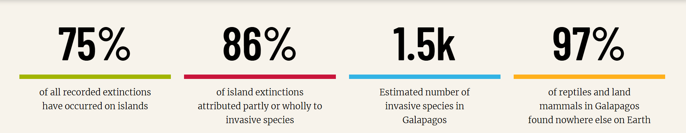



# Conservation and Conflict on the Islands 1979-2019

A spatial history of the Galápagos Islands and the places it was tied to.

## The Galápagos Islands- As an interconnected place

<iframe src="map/" height="600" style="width: 150%; max-width: 95vw; display: block; position: relative; left: 50%; transform: translateX(-50%); border: 1px solid #ccc; border-radius: 8px;"></iframe>
 

## Trouble in Paradise
 
The Galápagos Islands are an collection of islands in the Pacific Ocean, around 600 miles from mainland Ecuador. Only about 3% of the islands is inhabited by humans, consisting of four islands: Santa Cruz, San Cristóbal, Isabela, and Floreana. [^1] What makes this archipelago particularly special is that the islands and surrounding waters are endemic to a multitude of species. [^2] Despite appearing quite secluded, the Galápagos Islands are connected to far reaches of the world. The map above and the following essay have narrowed their focus on mainland Ecuador, parts of Western Europe, and parts of East Asia, due to connected conservation efforts and environmental threats. Seeing as 97% of the islands are protected as a national park reserve for wildlife, they're vulnerable to a variety of threats that require international cooperation to adequately address. [^1] Over the years, the Ecuadorian government has made efforts to satisfy the need of the residents, wildlife, and ecosystem while also allowing for tourists to experience the one of a kind environment.

  

    
     
    <em>"Islands in numbers"<a href="#fn:1">1</a></em>
  

For a deeper dive into the development of the map, the selection of places, and detailed explanations of the events and legislation:
[Read the essay](essay.html)

[^1]: Galapagos Conservation Trust, [*Global relevance*](https://galapagosconservation.org.uk/about-galapagos/why-galapagos-matters/global-relevance/) (Galapagos Conservation Trust, n.d.).
[^2]: Galápagos Conservancy, [*Biodiversity*](https://www.galapagos.org/about_galapagos/biodiversity/) (Galápagos Conservancy, n.d.).
